# Manual de usuario

Guía de uso diario del sistema de farmacia, por tarea. Las imágenes usan datos **ficticios** de
demostración.

> El sistema es una **herramienta administrativa y de registro**. Transcribe lo que indica el
> médico; nunca sugiere, calcula ni determina tratamientos.

**Contenido**

1. [Entrar al sistema](#1-entrar-al-sistema)
2. [El dashboard](#2-el-dashboard)
3. [Vender en el punto de venta](#3-vender-en-el-punto-de-venta)
4. [Antibióticos y productos con receta](#4-antibióticos-y-productos-con-receta)
5. [Cancelaciones y devoluciones](#5-cancelaciones-y-devoluciones)
6. [Inventario: existencias, lotes y ajustes](#6-inventario-existencias-lotes-y-ajustes)
7. [Caducidades y alertas](#7-caducidades-y-alertas)
8. [Compras a proveedores](#8-compras-a-proveedores)
9. [Pacientes y recetas](#9-pacientes-y-recetas)
10. [Reportes](#10-reportes)
11. [Auditoría](#11-auditoría)
12. [Configuración](#12-configuración)
13. [Usuarios, roles y permisos](#13-usuarios-roles-y-permisos)
14. [Preguntas frecuentes](#14-preguntas-frecuentes)

---

## 1. Entrar al sistema

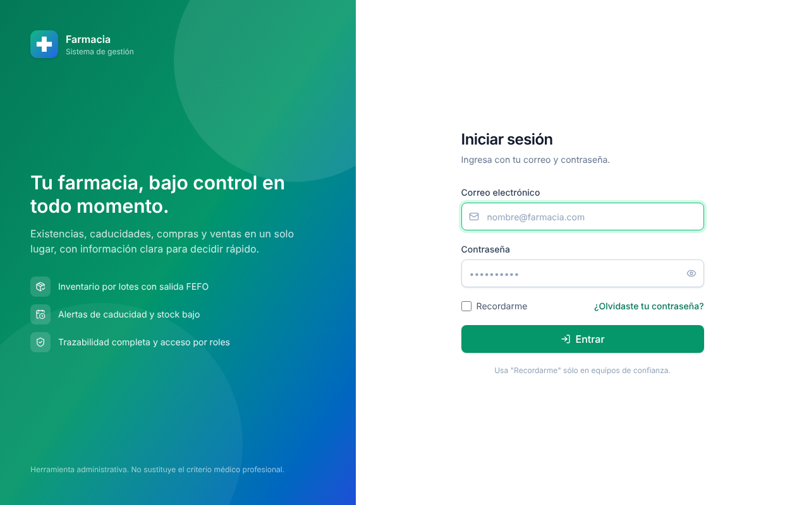

- Escribe tu correo y tu contraseña y pulsa **Entrar**.
- **Recordarme** mantiene la sesión abierta hasta 30 días. Úsalo sólo en equipos de confianza;
  sin marcarlo, la sesión dura una jornada (12 horas).
- La **primera vez** el sistema te pide cambiar la contraseña. Debe tener al menos 10 caracteres,
  con letras y números.
- Tras **5 intentos fallidos** la cuenta se bloquea 15 minutos. Un administrador puede
  desbloquearla antes desde **Usuarios**.
- **¿Olvidaste tu contraseña?** envía un enlace al correo (válido 30 minutos) si el servidor tiene
  correo configurado. Si no, pide a un administrador **Restablecer contraseña**.
- Para cambiar tu contraseña después: menú de tu nombre (arriba a la derecha) → **Mi perfil**.

Cada quien ve sólo los módulos que su rol permite. La cajera, por ejemplo, entra directo al punto
de venta.

## 2. El dashboard

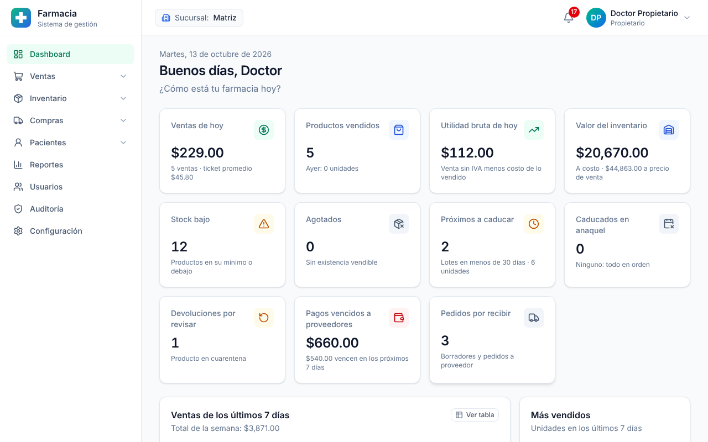

Resume la sucursal **hoy** y se actualiza solo cada minuto:

- **Ventas de hoy** contra ayer, número de ventas y ticket promedio.
- **Utilidad bruta de hoy** y **valor del inventario** (sólo para quien ve datos financieros).
- **Stock bajo**, **agotados**, **próximos a caducar** y **caducados en anaquel**.
- **Devoluciones por revisar**, **pedidos por recibir** y **pagos vencidos a proveedores**.
- Ventas de los últimos 7 días (pasa el cursor sobre una barra para ver el detalle, o pulsa
  **Ver tabla**), los más vendidos y las últimas ventas.

Cada tarjeta lleva al módulo donde se atiende. Sin permiso de reportes, el farmacéutico ve
**sus propias** ventas.

**Sucursal:** si trabajas en varias, elige la sucursal en la parte superior; inventario, ventas y
compras son de la sucursal elegida.

## 3. Vender en el punto de venta

**Ventas → Punto de venta.**

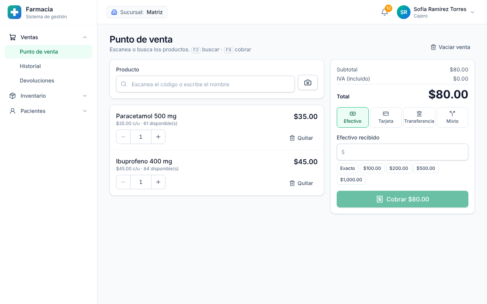

1. **Escanea** el código de barras con el lector (o con la cámara: botón 📷), o escribe el nombre
   y elige el producto. Atajo: **F2** para buscar.
2. Ajusta la cantidad con **−** / **+**. El sistema avisa si no hay existencia suficiente.
3. Elige la forma de pago: **Efectivo**, **Tarjeta**, **Transferencia** o **Mixto**.
   En efectivo, escribe lo recibido (o usa los botones de billetes); el sistema calcula el cambio.
4. Pulsa **Cobrar** (atajo **F9**). Al terminar puedes **imprimir el ticket**.

Lo que hace el sistema por ti:

- Toma primero el lote que **caduca antes** (FEFO) y nunca vende un lote caducado o en cuarentena.
- Calcula precios e IVA desde el catálogo; el precio no se puede alterar en la caja.
- Si la red falla y vuelves a pulsar **Cobrar**, **no cobra dos veces**.
- Dos cajas al mismo tiempo no pueden vender la misma unidad.

**Corte de caja:** **Ventas → Historial** muestra el corte de hoy por forma de pago y el
efectivo que debe haber en caja (ventas en efectivo menos reembolsos en efectivo).

## 4. Antibióticos y productos con receta

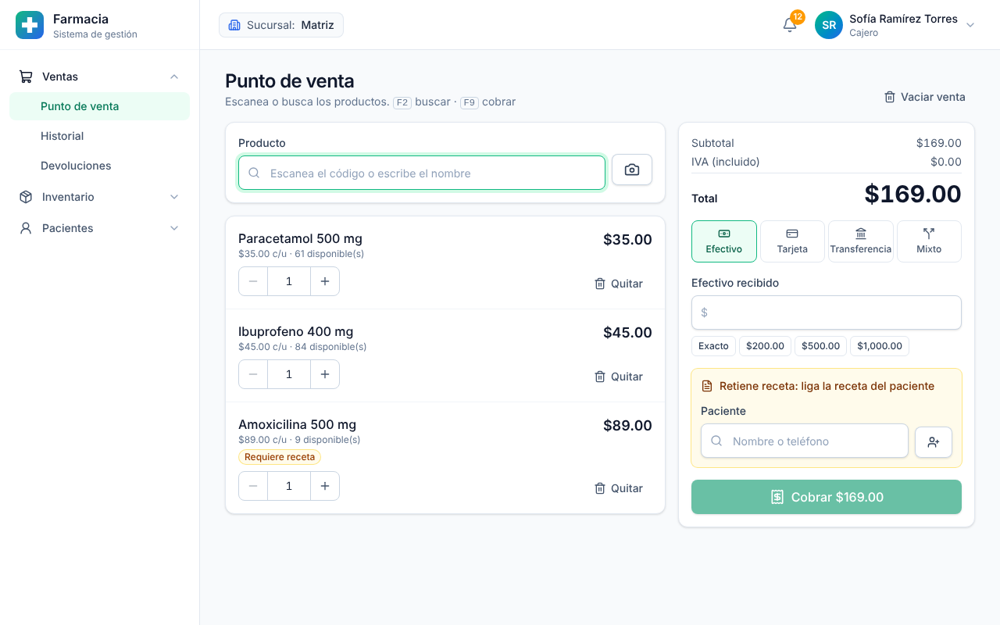

- **Antibióticos y controlados (retienen receta):** la venta **exige** ligar la receta del
  paciente, la venda quien la venda.
  1. En el recuadro amarillo busca al paciente por nombre o teléfono. Si no existe, regístralo
     con el botón 👤+ (nombre, apellidos y, opcional, fecha de nacimiento y teléfono).
  2. Elige una receta suya **sin surtir**, o **Registrar la receta que trae el paciente**
     (médico, cédula opcional de 7 u 8 dígitos y fecha).
  3. Cobra normalmente. Una receta retenida **se surte una sola vez**.
- **Productos que sólo requieren receta:** marca **Revisé la receta médica del paciente**.

## 5. Cancelaciones y devoluciones

En **Ventas → Historial** abre la venta:

- **Cancelar venta** (sólo con permiso; pide el motivo): regresa las unidades a los mismos lotes
  de los que salieron. La venta queda en el historial como cancelada.
- **Devolución:** elige el producto, la cantidad, cómo se reembolsa y el **destino**:
  - *Regresar al inventario*: vuelve a venta.
  - *Cuarentena*: queda apartado hasta que alguien lo revise.
  - *Desechar*: no regresa al inventario (cuenta como merma).
- **Ventas → Devoluciones** muestra lo pendiente de revisar: **Regresar al inventario** o
  **Desechar**.

## 6. Inventario: existencias, lotes y ajustes

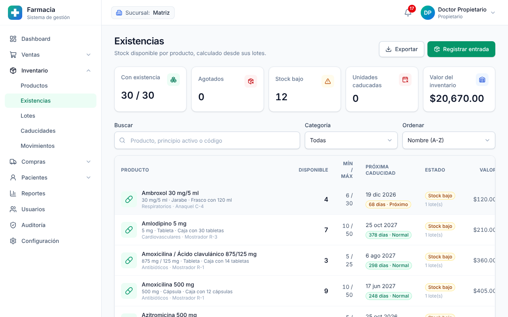

- **Inventario → Productos:** catálogo (nombre comercial, genérico, principio activo, código de
  barras, categoría, laboratorio, precios, IVA, receta, foto). El precio sugerido usa el margen
  de **Configuración**. El farmacéutico pone el precio al dar de alta; cambiarlo después requiere
  permiso de cambio de precio.
- **Inventario → Existencias:** stock vendible por producto, con filtros de stock bajo, agotados
  y caducados, y exportación a CSV. Abre un producto para ver **sus lotes** (lote, caducidad,
  cantidad) y sus movimientos.
- **Registrar entrada:** carga inicial o entrada manual con lote y caducidad. Las compras a
  proveedor entran solas al recibirlas (ver sección 8).
- **Ajustar o contar** (permiso de ajuste): salidas por daño, caducidad, robo, consumo interno o
  corrección de conteo, y entradas por corrección. **Siempre con motivo.**
- **Inventario → Movimientos:** bitácora de cada entrada y salida, con quién, cuándo, cantidad
  antes y después. **No se puede modificar ni borrar.**

## 7. Caducidades y alertas

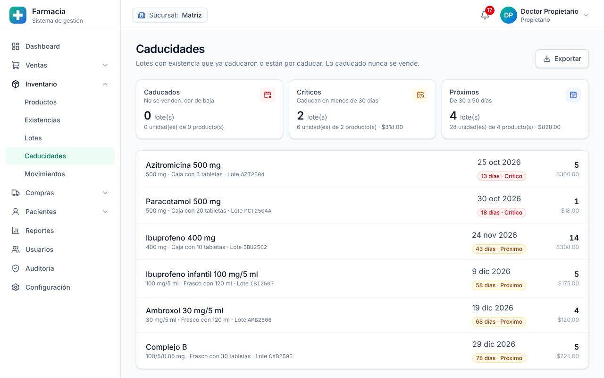

- **Inventario → Caducidades** separa los lotes en **Caducados** (no se pueden vender: dalos de
  baja con un ajuste), **Críticos** y **Próximos**. Los días de cada grupo se definen en
  **Configuración → Alertas de caducidad** (30 y 90 por omisión).
- La **campana** 🔔 avisa de agotados, stock bajo, lotes por caducar o caducados, pedidos sin
  recibir y pagos a proveedores por vencer. Cada aviso lleva a donde se resuelve y desaparece solo
  cuando el problema se corrige.

## 8. Compras a proveedores

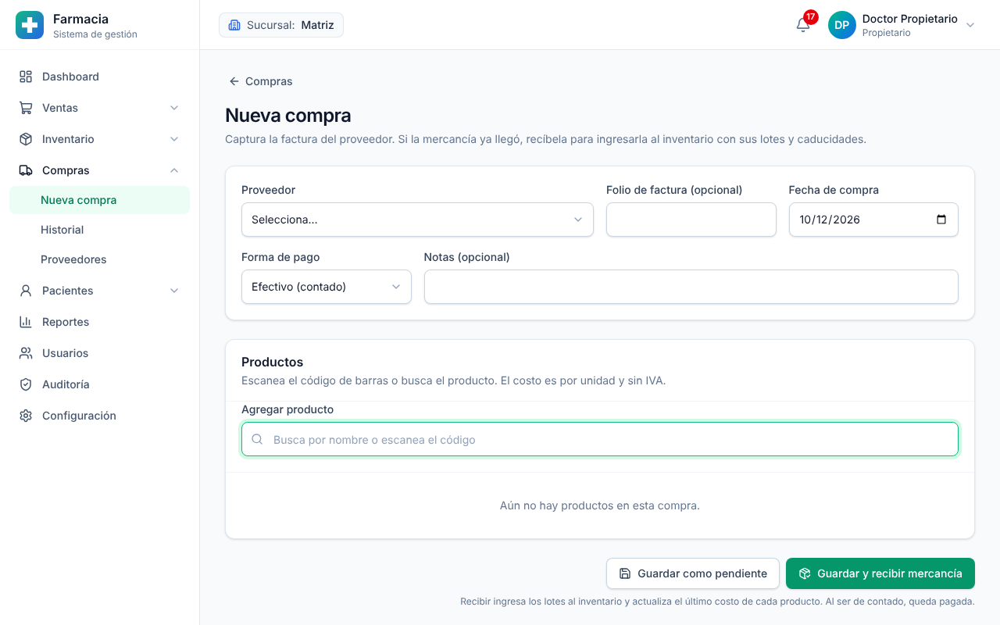

1. **Compras → Proveedores:** da de alta al proveedor (RFC, contacto, días de crédito).
2. **Compras → Nueva compra:** proveedor, número de factura, fecha, forma de pago y partidas
   (producto, cantidad, costo, descuento, IVA, lote y caducidad).
   - **Guardar como pendiente** si es un pedido que aún no llega (lote y caducidad pueden esperar).
   - **Guardar y recibir mercancía** si ya la tienes: entra al inventario en ese momento.
3. En el detalle de la compra: **Recibir mercancía** (pide lotes y caducidades), **Registrar pago**
   (abonos parciales o totales) y **Cancelar compra** (con motivo). Una compra ya recibida sólo se
   cancela si no tiene pagos y sus unidades siguen en el lote: el sistema las retira del inventario.
   Si ya se vendieron, registra la devolución al proveedor como ajuste de inventario.

Las compras a crédito calculan su vencimiento con los días de crédito del proveedor y avisan
antes de vencer.

## 9. Pacientes y recetas

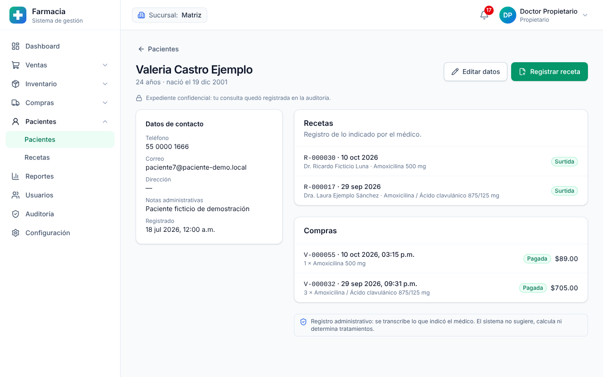

- **Pacientes:** búsqueda sin acentos por nombre, teléfono o correo. El listado muestra lo mínimo
  y el teléfono enmascarado.
- El **expediente** muestra datos de contacto, recetas y compras. **Cada consulta queda
  registrada** en la auditoría.
- **Registrar receta:** médico, cédula, fecha y los medicamentos **tal como vienen escritos**
  (dosis, frecuencia, duración e indicaciones). Se pueden vincular al producto del catálogo.
- Las recetas **no se editan ni se borran**. Si hay un error, el propietario o el administrador
  la **anula con un motivo** (no si ya se surtió) y se registra una nueva.
- **Pacientes → Recetas:** búsqueda por folio (`R-000012`), paciente, médico o cédula; impresión.

## 10. Reportes

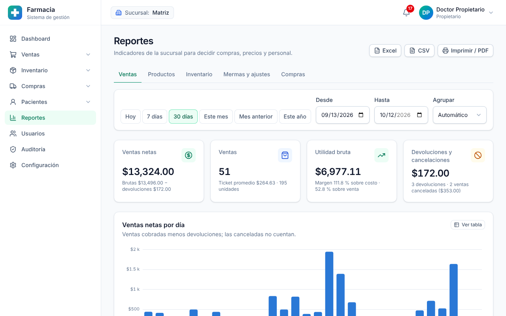

**Reportes** (propietario, administrador o quien tenga el permiso):

- Elige el periodo con los botones (**Hoy**, **7 días**, **30 días**, **Este mes**,
  **Mes anterior**, **Este año**) o con fechas, y agrupa por día, semana o mes.
- **Ventas:** netas (cobradas menos devoluciones), ticket promedio, utilidad y margen; por forma de
  pago, categoría, hora del día y usuario.
- **Productos:** los más vendidos y los **sin movimiento** (tienen existencia y no se vendieron).
- **Inventario:** valor por categoría y mercancía en riesgo (por caducar, caducada, cuarentena).
- **Mermas y ajustes:** bajas por motivo y por producto.
- **Compras:** por proveedor y cuentas por pagar.
- **Excel**, **CSV** e **Imprimir / PDF**. Cada exportación queda en la auditoría.

Cada gráfica tiene **Ver tabla** con los mismos datos. Costos y utilidad sólo aparecen para quien
tiene el permiso de reportes financieros.

## 11. Auditoría

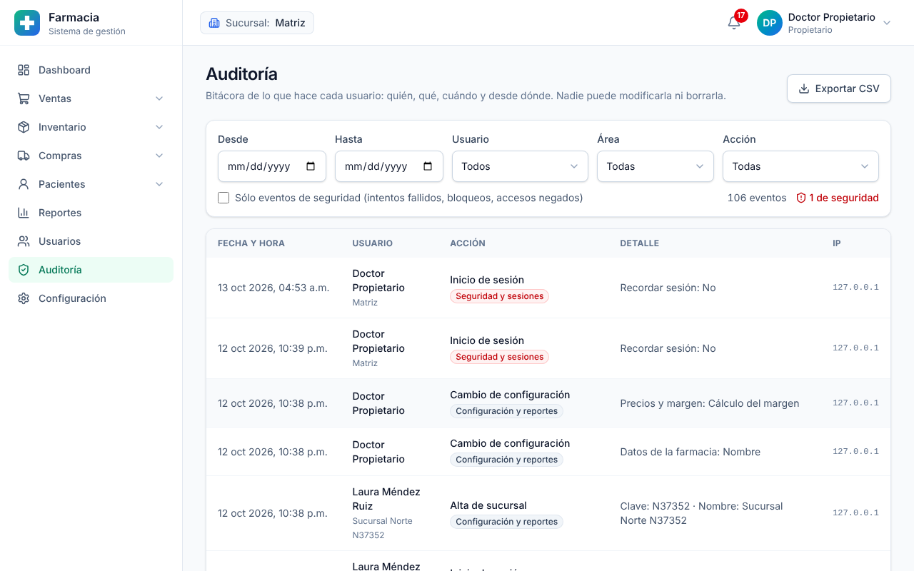

**Auditoría** (propietario y administrador) registra **todo** lo que hace cada usuario: quién, qué,
cuándo, desde qué IP y equipo, y en qué sucursal.

- Filtra por fechas, usuario, área y acción.
- **Sólo eventos de seguridad** muestra intentos de inicio de sesión fallidos, bloqueos y accesos
  negados. Conviene revisarlo cada semana.
- Pulsa un evento para ver el detalle; en los cambios de configuración se ve el **antes y el
  después**.
- **Exportar CSV** descarga lo filtrado. Nadie, ni el propietario, puede modificar o borrar la
  bitácora.

## 12. Configuración

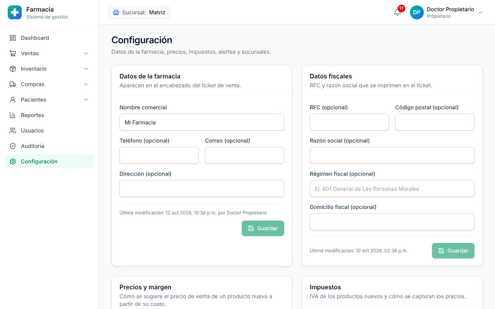

**Configuración** (la consultan quienes tienen permiso; la cambian el propietario y el
administrador):

- **Datos de la farmacia** y **datos fiscales:** aparecen en el ticket.
- **Precios y margen:** elige si el margen predeterminado es **sobre el costo** (costo $100 con
  30 % → $130) o **sobre el precio de venta** (costo $100 con 30 % → $143: la utilidad es el 30 %
  del precio). El ejemplo se actualiza al escribir.
- **Impuestos:** IVA predeterminado de productos nuevos y si los precios ya incluyen el IVA (lee la
  advertencia antes de cambiarlo).
- **Alertas de caducidad:** días críticos y de aviso.
- **Sucursales:** alta, edición y desactivación (el historial se conserva).

Cada cambio queda en la auditoría.

## 13. Usuarios, roles y permisos

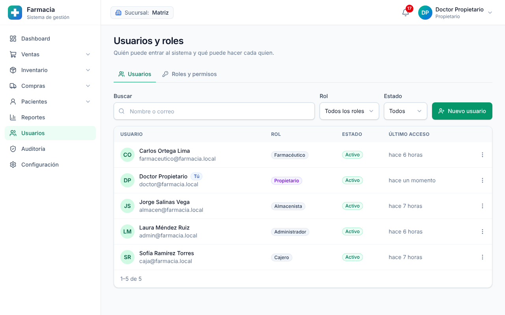

**Usuarios** (propietario y administrador):

- **Nuevo usuario:** nombre, correo, rol y sucursales. El sistema genera una contraseña temporal
  que la persona cambia al entrar.
- Acciones: **Editar**, **Restablecer contraseña**, **Desbloquear cuenta**, **Cerrar sus sesiones**
  (p. ej. si perdió el celular) y **Desactivar** (sin borrar su historial).
- **Roles:** el propietario crea roles a la medida y marca sus permisos. Los permisos sensibles
  (costos, cancelaciones, ajustes de inventario, pacientes, auditoría) están señalados.

Roles incluidos:

| Rol | Puede |
|---|---|
| Propietario | Todo |
| Administrador | Todo excepto administrar roles |
| Doctor | Inventario (consulta), pacientes y recetas |
| Farmacéutico | Productos, inventario y ajustes, ventas, devoluciones, pacientes y recetas |
| Cajero | Punto de venta y sus ventas, devoluciones (consulta), pacientes (para la receta al cobrar) |
| Almacenista | Inventario, compras, recepción y proveedores |

## 14. Preguntas frecuentes

**El lector de códigos no agrega el producto.** Revisa que el cursor esté en el campo
**Producto** (F2). Si el código no está registrado, el sistema lo indica: agrégalo en la ficha del
producto.

**No me deja vender un producto que sí está en el anaquel.** Su lote puede estar caducado, en
cuarentena o sin registrar. Revisa **Existencias → el producto → Lotes**.

**¿Por qué no veo costos ni utilidad?** Tu rol no tiene el permiso de reportes financieros.

**Me equivoqué en una venta.** Cancélala (con permiso) o haz una devolución. No se borra:
queda el registro para la auditoría y el corte de caja.

**Me equivoqué en un ajuste de inventario.** Los movimientos no se borran: registra un ajuste en
sentido contrario con el motivo *Error de captura*.

**¿Qué hago si alguien dejó la sesión abierta?** Un administrador puede **Cerrar sus sesiones**
desde **Usuarios**.

**¿Dónde están los respaldos?** Los programa quien instaló el sistema; ver
[DESPLIEGUE.md](DESPLIEGUE.md#5-respaldos-diarios).
